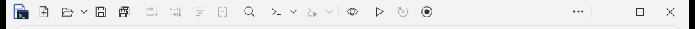
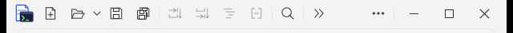

**English** | [繁體中文](windows-titlebar.md)

[← Back to the README](../README.en.md)

# Custom title bar and Windows 11 Snap Layouts

On Windows the system title bar is removed and **the main toolbar doubles as the title bar**. This document describes its layout, how dragging and resizing work, and the hardest problem: getting the Windows 11 Snap Layouts flyout to appear on the custom-drawn maximize button. For how to use the app, see the [README](../README.en.md).

| Platform | Title bar | Resizing from the window edges |
|---|---|---|
| Windows | Custom (this document) | Handled by intercepting `WM_NCHITTEST` (`ui/src/win_frame.rs`) |
| macOS, Linux | Native | Handled by the system |

macOS and Linux are **not** enabled yet: a custom title bar means handling edge resizing yourself, and only Windows has that. The switch is `CUSTOM` in `ui/src/window_chrome.rs`.

## Layout

- The app icon is on the far left; settings ("⋯") and the minimize, maximize (restore) and close buttons are on the far right.
- Empty toolbar space drags the window; a double-click toggles maximize and restore.
- The window title (what the taskbar and Alt+Tab show) is still set to "file name - FEditor"; it just isn't drawn inside the window. The version number lives on the "About" page of the settings panel.
- The tab bar is always shown (even with one pane and one tab), so the toolbar stays at the top and the layout doesn't jump when the number of panes changes.

### When it does not fit: the "more" drop-down

The toolbar has 6 groups, and a group is shown or moved into the `»` drop-down **as a whole**:

| # | Group | Contents |
|---|---|---|
| 0 | File | New, Open (with recent files), Save, Save As |
| 1 | Format | Convert indentation, Reformat, Surround |
| 2 | Find | Find and replace |
| 3 | Terminal | New terminal (with the shell list), run the file (with command-line arguments) |
| 4 | Preview | The preview toggle |
| 5 | Macros | The macro panel, rerun, record |

The settings button and the three window buttons are not in these six groups: they are **pinned to the right** and are never hidden.

How it works (`App::toolbar`):

1. After each group is drawn, its real width is measured and stored in egui's temporary data (`toolbar_group_widths`). The first frame draws everything; widths are available from the next frame on.
2. Available width = the right edge of the toolbar − the fixed area on the right (window buttons, settings) − the width taken by the icon.
3. If everything fits, everything is drawn. If not, groups are moved into the drop-down starting from the last one, until "the groups still shown + a separator + the 'more' button" fit.
4. The hidden groups are drawn inside the `»` drop-down, one group per row, with the **same drawing function** (`App::toolbar_group`), so the buttons behave exactly the same.
5. The macro panel needs an anchor when it opens: when the macro button is hidden, the position of the `»` button is used instead.
6. The minimum window width is 480 points (`MIN_WINDOW_WIDTH`): enough for the icon, `»`, the settings button and the three window buttons.

## Dragging and maximizing

- The toolbar first registers one full-width drag area (`window_chrome::drag_area`). **It must be registered before the other buttons**, so the buttons sit on top of it and clicking one doesn't drag the window.
- Pressing to drag sends `ViewportCommand::StartDrag` and the system moves the window; a double-click sends `Maximized(!current state)`.
- The close button sends `ViewportCommand::Close`, which goes through the normal close flow and asks first if there are unsaved changes.

## The Windows window procedure

With the system title bar gone, winit's undecorated window has two problems: most of the window edge can't be grabbed (only the very top edge resizes), and the maximize button has no Snap Layouts flyout. After the window is created, `win_frame::install` installs its own window procedure with `SetWindowLongPtrW(GWLP_WNDPROC)` and intercepts three kinds of messages.

`SetWindowSubclass` is not used: it lives in comctl32, and without a manifest asking for v6 the older version that gets loaded does not necessarily export that function.

### `WM_NCCALCSIZE`: keep the native frame, take back only the title bar

This is the key to getting Snap Layouts to appear.

1. When `wParam` is 0, return 0 right away.
2. Otherwise, remember the **top** of the client area the system proposed, then call `DefWindowProcW` so Windows computes the native frame as usual.
3. Keep the **left, right and bottom** borders the system computed, and put only the top of the client area back to the original top: the title bar area goes back to the client area for egui to draw.
4. When maximized, the native resize border lies off-screen, so add `GetSystemMetricsForDpi(SM_CYSIZEFRAME, dpi) + GetSystemMetricsForDpi(SM_CXPADDEDBORDER, dpi)` to the top; otherwise the top of the content is clipped.
5. Right after installing the window procedure, call `SetWindowPos(SWP_FRAMECHANGED | SWP_NOACTIVATE | SWP_NOMOVE | SWP_NOSIZE | SWP_NOZORDER)` to force the system to recompute the frame once.

The point is to **keep the native frame continuously**: you can't initialize it once at startup and then empty the whole non-client area afterwards.

### `WM_NCHITTEST`: resize zones and the maximize button

Checked in order; the first match is returned:

| Order | Condition | Returns |
|---|---|---|
| 1 | The window is not maximized and the point is within 6 points of an edge (12 points at each corner) | `HTLEFT`, `HTTOP`, `HTTOPLEFT`, … |
| 2 | The point is within the custom maximize (restore) button | `HTMAXBUTTON` |
| 3 | Anything else | `HTCLIENT` |

- The edge width scales with DPI (`GetDpiForWindow`).
- The coordinates in `lParam` are **signed 16-bit** values and can be negative on multi-monitor setups, so convert with `as i16`.
- The UI reports the maximize button's rectangle every frame (`set_max_button`, converted to physical pixels in client coordinates); a hit is converted with `ScreenToClient`.
- Item 3 answers `HTCLIENT` explicitly so the system never treats the native title bar that no longer exists, or a hidden button, as hit.

### Mouse messages over the maximize button

Once `HTMAXBUTTON` is returned, mouse messages over that button become non-client messages and **never reach egui**, so they are handled here:

| Message | Handling |
|---|---|
| `WM_NCMOUSEMOVE` (over the maximize button) | Set the hover flag so the UI draws the gray background; the message is **passed on to the system as usual** — Snap Layouts is triggered by it |
| `WM_NCMOUSELEAVE`, `WM_MOUSEMOVE` | Clear the hover flag |
| While the hover flag is set | Every frame, check with `GetCursorPos` that the cursor is still on the button, and repaint about every 60 ms; the highlight goes away when the mouse leaves |
| `WM_NCLBUTTONDOWN` | Return 0 and don't pass it on (the system would try to draw a title-bar button that doesn't exist) |
| `WM_NCLBUTTONUP` | Post `WM_SYSCOMMAND`: `SC_RESTORE` when maximized, otherwise `SC_MAXIMIZE` |

The cost: egui can't see the cursor while it is over the maximize button, so that button has no tooltip.

## The problem: the Snap Layouts flyout does not appear

### Symptom

The custom maximize button could be clicked, maximized the window and had a hover background, and diagnostic logging showed `WM_NCHITTEST` returning `HTMAXBUTTON` for that spot and `WM_NCMOUSEMOVE` arriving, but hovering over it never made the Windows 11 Snap Layouts flyout appear. The same program with a native title bar showed it fine.

### Root cause

winit's undecorated mode folds the whole non-client area into the client area. For such a window, Windows 11 does not show Snap Layouts even if `WM_NCHITTEST` reports `HTMAXBUTTON`; the window has to **keep its native frame** (giving up only the title bar). The Microsoft documentation we read only mentions returning `HTMAXBUTTON` for a custom title bar and does not mention this condition; it is a conclusion reached by comparing against the native title bar and against how Windows Terminal does it.

### The fix

Follow Windows Terminal's `NonClientIslandWindow::_OnNcCalcSize`: intercept `WM_NCCALCSIZE`, keep the frame and take back only the title bar (see the `WM_NCCALCSIZE` section above).

### What was tried and did not work

| Approach | Result |
|---|---|
| Only reporting `HTMAXBUTTON` | Hit-testing, hover and clicks all worked; no flyout |
| Calling `TrackMouseEvent` ourselves to track the mouse leaving | No flyout |
| Extending the frame with `DwmExtendFrameIntoClientArea` | No flyout |
| Forwarding extra messages to `DwmDefWindowProc` | No flyout |
| Initializing the native title bar once at startup only | No flyout |
| Adding a Windows compatibility manifest | No flyout |

The Tauri trick found online, overlaying a transparent child window that reports `HTMAXBUTTON`, does not apply here: it exists because WebView2's child windows swallow the mouse, so the top-level window's `WM_NCHITTEST` is never asked. FEditor has no child windows; the top-level window receives the mouse messages.

### Verifying and debugging

- **Compare**: switch the same program back to the native title bar and see whether the flyout appears; first make sure the system setting (Settings → System → Multitasking → Snap windows) is not turned off.
- **Ask the window procedure directly**: use `SendMessage(hwnd, WM_NCHITTEST, 0, MAKELPARAM(x, y))` for a few positions (left edge, the corners, the maximize button, the middle of the window) and check for `HTLEFT`, `HTBOTTOMLEFT`, `HTMAXBUTTON` and `HTCLIENT`; no mouse movement needed.
- **Screenshots can't see it**: `PrintWindow` can't capture the Snap Layouts flyout that DWM draws on top; use Windows.Graphics.Capture, or just look at it.

## References

- [Windows Terminal: `NonClientIslandWindow.cpp`](https://github.com/microsoft/terminal/blob/main/src/cascadia/WindowsTerminal/NonClientIslandWindow.cpp) (`_OnNcCalcSize`)
- [Chromium: `hwnd_message_handler.cc`](https://github.com/chromium/chromium/blob/main/ui/views/win/hwnd_message_handler.cc)
- [Microsoft Learn: Support snap layouts for desktop apps on Windows 11](https://learn.microsoft.com/en-us/windows/apps/desktop/modernize/ui/apply-snap-layout-menu)
